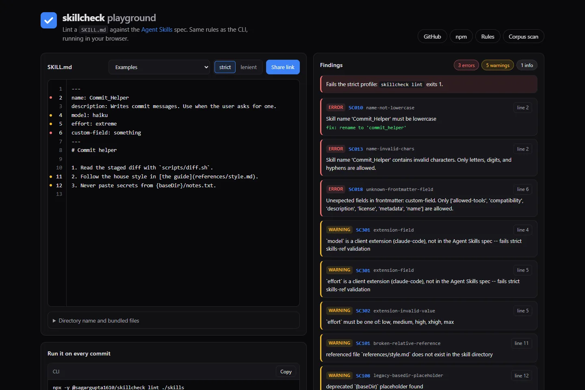
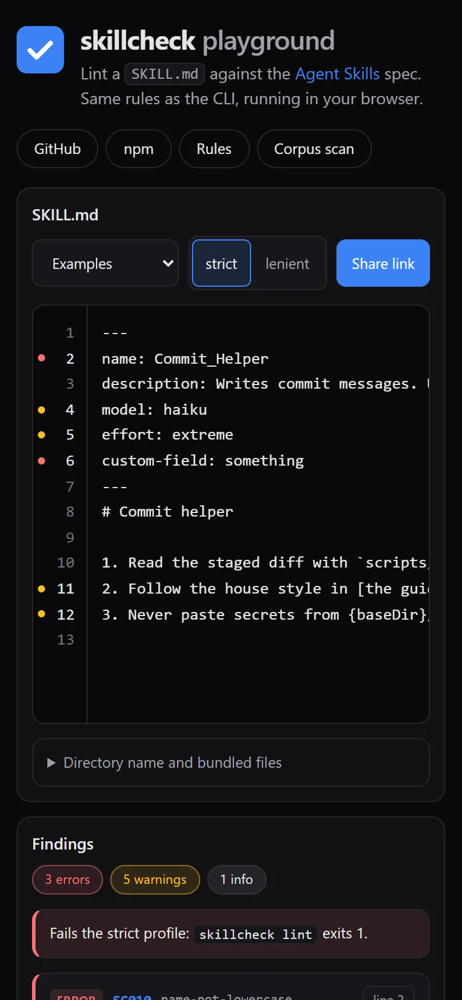
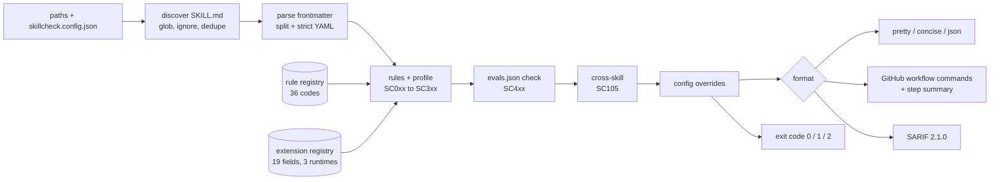

# skillcheck

[](https://www.npmjs.com/package/@sagargupta1610/skillcheck)
[](https://github.com/Sagargupta16/skillcheck/actions/workflows/ci.yml)
[](https://github.com/marketplace/actions/skillcheck-for-agent-skills)
[](LICENSE)
[](package.json)

Conformance suite for [Agent Skills](https://agentskills.io) (`SKILL.md`).

Linters check syntax. skillcheck checks reality: 36 rules with exact [skills-ref](https://github.com/agentskills/agentskills/tree/main/skills-ref) parity (verified against the reference validator's source, message for message), a 19-field client-extension registry across 3 runtimes, structure and reference validation, trigger-test scaffolding, SARIF output, and a drop-in GitHub Action.

```
$ skillcheck lint ./skills

commit_helper  ./skills/commit-helper
  WARN [SC301 extension-field] `model` is a client extension (claude-code), not in the Agent Skills spec -- fails strict skills-ref validation
  ERR  [SC013 name-invalid-chars] Skill name 'commit_helper' contains invalid characters. Only letters, digits, and hyphens are allowed.
  ERR  [SC014 name-dir-mismatch] Directory name 'commit-helper' must match skill name 'commit_helper'
  WARN [SC101 broken-relative-reference] referenced file `references/style.md` does not exist in the skill directory

1 skill(s) checked: 2 error(s), 2 warning(s), 0 info
```

Findings point at the line that caused them (the `name:` key, the broken link), so PR annotations land on the right line of the diff.

## Playground

Paste a SKILL.md and see the findings as you type: [sagargupta16.github.io/skillcheck](https://sagargupta16.github.io/skillcheck/). It runs the same rule modules as the CLI, bundled for the browser, so nothing is uploaded. Share links carry the skill in the URL hash.

<p>
  
  
</p>

The playground covers the per-file rules. Checks that need a real directory (SC001, SC020, SC103, SC105, SC106, SC4xx) run in the CLI only.

## What it finds in public skills

[docs/corpus.md](docs/corpus.md) is skillcheck run over 2,081 skills in 18 public repositories (Anthropic, OpenAI, Vercel, Hugging Face, Cloudflare, Microsoft, GitHub, Stripe, Trail of Bits and others), each pinned to a commit. `pnpm corpus` regenerates it.

- 877 skills (42.1%) have at least one error under the default strict profile. 833 of those are in one repository, ComposioHQ/awesome-claude-skills, almost all for a non-spec `requires:` field. Without it: 44 of 1,217 skills (3.6%).
- 7 of the 18 repositories ship at least one skill with an error.
- The most common error is SC018 unknown-frontmatter-field (849 skills), then SC013 name-invalid-chars (90) and SC014 name-dir-mismatch (85).
- A full strict pass over all 2,081 skills took a median 4.8 s (2.29 ms per skill) on the machine named in the report.

The scan also tested skillcheck itself. It found that discovery skipped dot directories (`.claude/skills`, `.github/skills`), which hid 261 skills, and that SC101 fired on directory links, `{baseDir}` paths, globs and placeholder text. Both are fixed in 0.2.7.

## Why

The Agent Skills standard is adopted by 40+ runtimes (Claude Code, Codex, Gemini CLI, Copilot, Cursor, OpenCode, ...) and its ecosystem has a built-in tension: the official reference validator (`skills-ref`) is **strict** -- unknown frontmatter fields fail -- while real clients are **lenient** -- they warn and load anyway. Claude Code alone ships 18 extension fields that fail strict validation.

skillcheck is the only linter that models both tiers:

| Tier | Meaning |
| --- | --- |
| **error** | skills-ref 0.1.0 strict parity: exact messages, exact check order, exact i18n semantics |
| **warning** | client-guide lenient tier + beyond-parity checks (broken references, hidden unicode, portability) |
| **info** | advisory; never gates CI |

## Quick start

```bash
# no install
npx -y @sagargupta1610/skillcheck lint ./skills

# or as a dev dependency
pnpm add -D @sagargupta1610/skillcheck
```

```bash
skillcheck lint ./my-skill                 # one skill
skillcheck lint ./my-skill/SKILL.md        # or point straight at the file
skillcheck lint ./skills                   # every SKILL.md under a tree
skillcheck lint . --profile lenient        # client-guide severities
skillcheck lint . --format concise         # one line per finding
skillcheck lint . --format json            # machine-readable
skillcheck lint . --format sarif           # SARIF 2.1.0 to stdout
skillcheck lint . --sarif report.sarif     # sidecar SARIF alongside any format
skillcheck lint . --badge badge.json       # shields.io endpoint badge (see Badge)
skillcheck lint . --fail-on warning        # stricter CI gate
skillcheck lint . --max-warnings 10
skillcheck lint . --ignore-pattern 'fixtures/**' 'vendor/**'

skillcheck eval init ./my-skill            # scaffold evals/evals.json
skillcheck eval check ./my-skill           # validate it
```

`--ignore-pattern` adds to the `ignore` array in `skillcheck.config.json` rather than replacing it.

Exit codes: `0` clean, `1` findings at or above `--fail-on`, `2` usage or internal error. An unrecognized `--profile`, `--format`, `--fail-on` or `--max-warnings` value is a usage error, not a silent fallback -- a typo in a workflow file fails loudly instead of quietly weakening the gate.

## GitHub Action

```yaml
jobs:
  skills:
    runs-on: ubuntu-latest
    steps:
      - uses: actions/checkout@v7
      - uses: Sagargupta16/skillcheck@v0.2.7
        with:
          path: skills/
          fail-on: error
          sarif-file: skillcheck.sarif   # optional
          badge-file: .github/skillcheck-badge.json   # optional, action v0.2.7+

      # optional: upload to code scanning (needs security-events: write)
      - uses: github/codeql-action/upload-sarif@v4
        with:
          sarif_file: skillcheck.sarif
          category: skillcheck
```

Inline PR annotations come free via workflow commands; a full report table lands in the job summary automatically. Action outputs: `error-count`, `warning-count`, `sarif-file`.

The action is listed on the [GitHub Marketplace](https://github.com/marketplace/actions/skillcheck-for-agent-skills). The tag pins `action.yml`; the CLI it runs comes from npm, set by the `version` input (default `latest`). Pin `version` too for fully reproducible CI.

## Badge

`--badge <path>` (or the action's `badge-file` input) writes a [shields.io endpoint](https://shields.io/badges/endpoint-badge) JSON: red with the error count, yellow with the warning count, green `N skills passing` otherwise. Commit it from CI and point shields at the raw file:

```markdown

```

The counts are taken after config overrides, so the badge agrees with the exit code.

## pre-commit

```yaml
repos:
  - repo: https://github.com/Sagargupta16/skillcheck
    rev: v0.2.7
    hooks:
      - id: skillcheck
```

The hook runs on staged `SKILL.md` files. It uses `language: system` and runs the npm release through `npx`, like the action does, so it needs Node 22+ on PATH. To pin the CLI version, override the entry: `entry: npx --yes @sagargupta1610/skillcheck@0.2.7 lint`.

## Rules

36 rules with stable codes (never renumbered or recycled). Full reference: [docs/rules.md](docs/rules.md).

| Range | Category | Examples |
| --- | --- | --- |
| SC0xx | Frontmatter (skills-ref parity) | SC010 name-not-lowercase, SC013 name-invalid-chars, SC018 unknown-frontmatter-field, SC021 unquoted-colon-description |
| SC1xx | Structure + references | SC101 broken-relative-reference, SC105 duplicate-skill-name, SC107 hidden-unicode (Trojan-Source) |
| SC2xx | Body | SC202 body-too-many-lines, SC203 body-too-many-tokens |
| SC3xx | Extensions / portability | SC301 extension-field (per-runtime table), SC302 extension-invalid-value |
| SC4xx | Evals | SC401 evals-invalid, SC402 evals-advisory |

Parity details worth knowing:

- Name validation is Unicode-aware, matching skills-ref exactly: `技能` and `мой-навык` pass, `skill_name` and `НАВЫК` fail.
- NFKC normalization applies to names and directory comparison -- composed vs decomposed `café` never false-positives.
- The frontmatter splitter replicates skills-ref's `split("---", 2)` semantics, including its known edge case (a literal `---` inside YAML values).
- Strict-YAML semantics are enforced on top of the JS parser: flow collections, tags, and duplicate keys are rejected, like `strictyaml`.
- The 19-field extension registry knows which of the three modeled runtimes read each field -- `model` is Claude Code only, `paths` is Claude Code + Cursor, `globs` is Cursor legacy -- and validates values (`effort: extreme` flags SC302). Fields absent from a runtime's current published frontmatter reference stay registered, so they warn instead of erroring, and say so in the message.

## Configuration

Optional `skillcheck.config.json` in your project root:

```json
{
  "rules": {
    "SC104": "off",
    "extension-field": "error"
  },
  "ignore": ["fixtures/**", "**/vendor/**"]
}
```

Codes and kebab-case aliases are interchangeable. Levels are `off`, `info`, `warn` (or `warning`) and `error`, and they apply to every finding, including evals (SC4xx) and cross-skill (SC105) ones. Zero-config works. A config that exists but is unusable (invalid JSON, an unknown rule, an unknown level) exits 2, like a bad flag.

`ignore` takes globs applied during discovery, relative to each path you pass on the command line, so vendored or fixture skills never reach the rules. `node_modules` and `.git` are always excluded.

## Evals (trigger tests)

`skillcheck eval init` scaffolds `evals/evals.json` -- a strict superset of Anthropic skill-creator's format (anything skill-creator writes, skillcheck validates unchanged) plus a `triggers` array covering four trigger classes: explicit, implicit, contextual, and negative (the near-misses that catch over-triggering). `skillcheck lint` validates the file automatically when present. Runtime execution of these tests lands in v0.3.

## How it works



| Piece | File | Why it is built this way |
| --- | --- | --- |
| Frontmatter splitter | [src/lint/parse.ts](src/lint/parse.ts) | Replicates skills-ref's `split("---", 2)` and strictyaml rules on top of the `yaml` parser, so an error here means the reference validator would fail too |
| Rule registry | [src/lint/registry.ts](src/lint/registry.ts) | One table drives the CLI, SARIF rule metadata and [docs/rules.md](docs/rules.md); CI regenerates the doc and fails on drift |
| Extension registry | [src/extensions.ts](src/extensions.ts) | Per-runtime frontmatter fields with value validators, so `model` warns as Claude Code only instead of a hard SC018 |
| Reference checks | [src/lint/links.ts](src/lint/links.ts) | CommonMark-aware link parsing (titles, angle brackets, fenced code skipped) shared by SC101 to SC103, with the source line of every reference |
| Pure lint core | [src/lint/source.ts](src/lint/source.ts) | Lints SKILL.md text with no filesystem, so the CLI and the [playground](site/) run the same code; a test checks both give identical findings |
| Corpus scan | [scripts/corpus-scan.ts](scripts/corpus-scan.ts) | Clones pinned commits of public skill repos and lints them with the built package, so every number in [docs/corpus.md](docs/corpus.md) is reproducible |
| Output | [src/output/](src/output/) | Repo-relative paths so annotations attach to the PR diff; workflow-command escaping so a hostile SKILL.md cannot inject `::error::` lines |

Picking `SKILL.md` over `skill.md` reads real directory entries rather than `readFile("SKILL.md")`, because case-insensitive filesystems on Windows and macOS would otherwise accept `skill.md` silently. CI runs ubuntu and windows on Node 22 and 24 for that reason.

## Roadmap

- [x] **v0.1** -- static lint, two-tier severity
- [x] **v0.2** -- skills-ref parity (verified message for message), rule codes, i18n names, structure/reference rules, extension registry with value validation, SARIF 2.1.0, evals scaffold + validation, GitHub Action, profiles, config
- [x] **v0.2.7** -- line-accurate findings, browser playground, corpus scan of 2,081 public skills, shields.io badge, pre-commit hook
- [ ] **v0.3** -- runtime execution: run trigger tests against Claude Code / OpenCode / Codex headlessly in Docker; `--fix` for safe fixes
- [ ] **v1.0** -- public caniuse-style compatibility matrix

## Development

```bash
pnpm install
pnpm test        # vitest: skills-ref parity, i18n names, reference parsing, workflow-command escaping
pnpm build       # tsup -> dist/*.js, tsc --emitDeclarationOnly -> dist/*.d.ts
pnpm lint        # biome
pnpm docs:rules  # regenerate docs/rules.md from src/lint/registry.ts
pnpm site:build  # playground -> dist-site/
pnpm site:serve  # serve dist-site/ on http://localhost:4173
pnpm corpus      # rebuild, scan the pinned public repos, rewrite docs/corpus.md
node dist/cli.js lint fixtures/valid-skill
```

Contributions welcome -- see [CONTRIBUTING.md](CONTRIBUTING.md).

## More AI Developer Tools

| Repo | What it is |
| --- | --- |
| [claude-code-recipes](https://github.com/Sagargupta16/claude-code-recipes) | Copy-paste recipes for Claude Code: commands, subagents, hooks, skills, MCP integration, workflow patterns |
| [claude-skills](https://github.com/Sagargupta16/claude-skills) | Claude Code plugin marketplace with skills for FARM stack, open source contributions, repo maintenance and portfolio management |
| [agent-recipes](https://github.com/Sagargupta16/agent-recipes) | Copy-paste AI agent workflows for real dev tasks: code review, testing, security scanning, DevOps automation |
| [mcp-toolkit](https://github.com/Sagargupta16/mcp-toolkit) | TypeScript middleware toolkit for MCP servers: authentication, caching, rate limiting, CORS, logging (beta) |
| [claude-cost-optimizer](https://github.com/Sagargupta16/claude-cost-optimizer) | Strategies, benchmarks and copy-paste configs for cutting Claude Code spend |

## License

[MIT](LICENSE)
